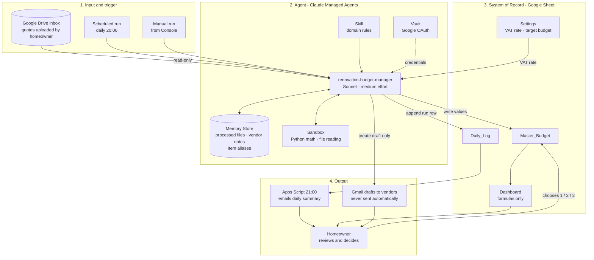
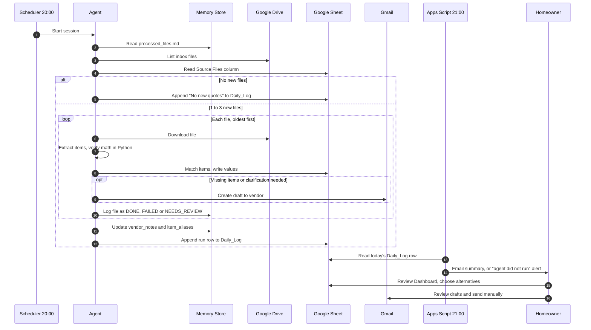
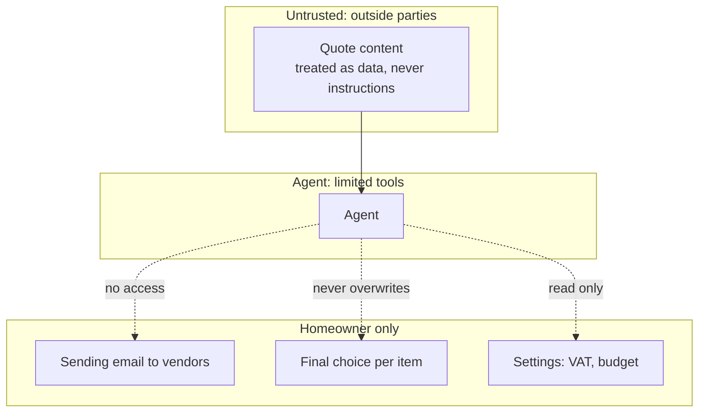

# Architecture.md — Renovation Budget Agent

**Course:** AiDO, Lesson 6 (AI Agents) · Assignment 4
**Companion to:** [SPEC.md](SPEC.md)

---

## 1. Overview

* **Where data comes from:** vendor quotes (PDF, Word, photos of handwritten estimates) that the homeowner uploads to a Google Drive inbox folder.
* **What triggers the agent:** a scheduled deployment every evening at 20:00 (`Asia/Jerusalem`), plus a manual run from the Console for urgent quotes.
* **Where data is stored:** one Google Sheet is the system of record. The agent's own notes live in the Managed Agents Memory Store.
* **Where the output goes:** updated budget rows, a live Dashboard tab, Gmail drafts to vendors (never sent automatically), and a daily summary email to the homeowner.

---

## 2. System Diagram

---

## 3. Components

| Layer | Component | Runs on | Role |
|-------|-----------|---------|------|
| Input | `Renovation_Quotes_Inbox` folder | Google Drive | Landing place for every vendor quote |
| Trigger | Scheduled deployment | Claude Managed Agents | Starts a session daily at 20:00 |
| Trigger | Manual session | Claude Console | On-demand run for urgent quotes |
| Agent | `renovation-budget-manager` | Claude Managed Agents | Reads quotes, extracts and matches items, writes the sheet, flags gaps |
| Agent | `renovation-domain` Skill | Claude Managed Agents | Fixed rules: dependencies, trade classes, item naming, VAT rule |
| Agent | Memory Store | Claude Managed Agents | What the agent did and learned between runs |
| Agent | Sandbox | Claude Managed Agents | Python for every calculation, reading PDF and image files |
| Agent | Vault | Claude Managed Agents | Google OAuth credentials, never visible to the model |
| Database | `Master_Budget` tab | Google Sheets | Every item, up to 3 vendor prices, the homeowner's choice, live totals |
| Database | `Settings` tab | Google Sheets | VAT rate and target budget, edited by the homeowner only |
| Dashboard | `Dashboard` tab | Google Sheets | Formula-only summary (see §6) |
| Output | `Daily_Log` tab | Google Sheets | One row per run: what changed, flags, open gaps, total |
| Output | Gmail drafts | Gmail | Clarification requests to vendors, sent only by the homeowner |
| Output | Daily summary script | Google Apps Script | Emails the latest Daily_Log row to the homeowner's fixed address |

---

## 4. One Run, Step by Step

Each file is logged in memory **right after** its rows are written. If a run stops in the middle (budget cap, turn limit, connector error), the next run continues from the first unlogged file without creating duplicate rows.

---

## 5. Who Writes Where

| Data | Agent | Homeowner | Formulas / scripts |
|------|:-----:|:---------:|:------------------:|
| Quote files in Drive | read only | uploads | - |
| Master_Budget item and price columns | writes values | may correct | - |
| Selected option (1/2/3) | new rows only, default 1 | chooses | - |
| Total column | never | never | formula |
| Dashboard tab | never | views | formulas |
| Settings tab | reads | edits | - |
| Daily_Log tab | appends | reads | Apps Script reads |
| Memory Store | reads and writes | can inspect | - |
| Gmail | drafts only | sends | Apps Script sends the summary |

---

## 6. Dashboard

The `Dashboard` tab is built from spreadsheet formulas only, so it is always current and the agent cannot break it.

| Section | Shows |
|---------|-------|
| Project total | Total ex-VAT, VAT, total incl. VAT, all based on the homeowner's current choices |
| Budget status | Target budget vs. current total, and the remaining amount |
| By room | Total per room (kitchen, master bath, balcony, …) |
| By trade | Total per trade (construction, carpentry, appliances, …) |
| Vendor comparison | For each tender trade, each vendor's full bid side by side |
| Open items | Number of rows marked NEEDS REVIEW and tender trades with fewer than 3 bids |

Changing a choice in `Master_Budget` from 1 to 2 updates every Dashboard number immediately. This is the "selection simulator".

---

## 7. Trust Boundaries

The agent has no tool that can send email, delete files or change the sheet's structure. Details are in [SPEC.md §5](SPEC.md#5-security--privacy).
